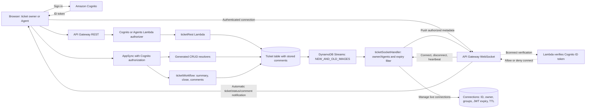

# Project5 B / pftest: support tickets

This branch is the isolated **B / pftest** control application for Project5.
Its separate frontend uses B's Cognito pool, B's original Gen1
GraphQL/REST/WebSocket APIs, and B's DynamoDB tables. See
[B frontend deployment](docs/B-FRONTEND.md) for release commands and evidence.
The original A site and Project5 C main branch are managed separately.

The sections below are retained source history from A; their original deployment
URLs and migration status do not describe this B branch. For B, use
`deployment.json`, `frontend/backend.json` and `frontend/hosting.json`.

## Preserved Gen1 source after completed migration — 8 October 2026

The original Cognito users, clients, identity pool, Agents and Connections resources are now owned by Project3; the original Ticket table is imported and retained. Gen1 infrastructure deployment is locked. This repository validates the retained source. Its original website URL now serves Project3’s Gen2 frontend, while existing open Gen1 clients can still use the retained APIs.

[Current three-project CI/CD](docs/CI-CD-AND-MIGRATION.md) · [Completed migration and evidence](https://github.com/gowthammail4macair/amplify-gen1-to-gen2-migration/blob/main/docs/STATEFUL-MIGRATION.md)


The SupportDesk frontend is included under [`frontend/`](frontend/README.md). Its separate S3/CloudFront hosting and full-stack deployment are managed by the GitHub workflow; live URLs are recorded in [`frontend/hosting.json`](frontend/hosting.json).

## Current live notifications and comments


[Two-browser notification sequence](docs/ticket-live-notifications-sequence.png) · [Diagram details and editable sources](docs/CURRENT-DIAGRAMS.md)

After sign-in, WebSocket updates connect automatically. Creating a ticket through
REST or GraphQL, changing its title/status, or adding a comment pushes an update
to its owner and authorized Agents. The queue, counters, selected status, and
comments update in other connected browsers. Pause/Resume reconnects and resyncs;
incoming updates preserve unsaved form edits.

Select a ticket to use its Status selector and Save changes, or its Comments
form and Add comment. Comments persist with verified authors and timestamps.

[Feature guide](docs/LIVE-UPDATES-AND-COMMENTS.md) · [Current API contract](docs/API-CONTRACT.md) · [Live CI results](evidence/live-feature-ci.json) · [Two-session browser checks](evidence/live-feature-browser.json)



[Original lookup architecture — historical](docs/support-ticket-architecture.png)

[CI/CD and infrastructure diagram](docs/ci-cd-infrastructure-gen1-gen2.png) · [Migration workflow diagram](docs/gen1-to-gen2-migration-workflow.png) · [Diagram notes](docs/CI-CD-AND-MIGRATION.md)

Task 1: an Amplify Gen 1 project covering REST, AppSync GraphQL and API Gateway WebSockets. It is published privately on GitHub and deployed in Mumbai. TypeScript, 30 runtime/UI tests, synthesis and all 17 live API check groups pass.

```bash
npm ci
npm run validate
```

Read [the implementation guide](docs/IMPLEMENTATION.md) for the steps used to build this project, and [the API contract](docs/API-CONTRACT.md) for requests and authorization behavior. [Synthesis evidence](evidence/synthesis.json) records the checks performed.

`amplify/backend/` contains native Gen 1 Auth, API and Function definitions. WebSockets are a Gen 1 custom CDK resource. `src/` is the canonical Lambda code; the prepare script copies only the modules required by each handler into its self-contained Gen 1 Lambda source folder and removes stale `.cjs` copies. Function package manifests list only their required libraries. `npm test` checks those packages in isolated directories and runs the backend suites against the packaged modules. CLI version 14.5.1 is pinned as the official source-distributed `@aws-amplify/cli-internal` package, whose binary is `amplify`. Node 22 is the target Lambda/runtime version. This session validated with Node 24.16.0.

`.github/workflows/deploy.yml` deploys commits to `main` using temporary OIDC credentials. `scripts/deploy.cjs` selects the configured `dev` environment, replaces offline validation metadata, initializes against the actual application and pushes the backend. See the cloud deployment guide for evidence and pipeline status.

## Cloud deployment follow-up

[Private GitHub repository](https://github.com/gowthammail4macair/amplify-gen1-fullstack) · [workflow, endpoints and live checks](docs/CLOUD-DEPLOYMENT.md) · [rough monthly cost](docs/COST-ESTIMATE.md).

The pipeline validates the code, deploys through short-lived GitHub OIDC credentials, and tests Cognito, REST, AppSync and WebSockets against AWS. `evidence/live-smoke.json` records the latest successful cloud check when present. The migration repository uses a separate environment with fresh resources.

### Deployed frontend

- [Open SupportDesk over HTTPS](https://d2i2kf1hg91937.cloudfront.net)
- [S3 website URL — redirects to HTTPS](http://support-d1zija7gqlw461-website-112097210422.s3-website.ap-south-1.amazonaws.com)

The live-notification version was verified on 7 October 2026: 30 local runtime/UI tests, 17 live API check groups, five hosting checks, and 12 two-session browser checks passed. See [current CI evidence](evidence/live-feature-ci.json) and [current browser results and cleanup](evidence/live-feature-browser.json). The [original lookup CI](evidence/fullstack-ci.json) and [original browser walkthrough](evidence/frontend-browser.json) are historical evidence. The browser delete-confirmation dialog was not exercised in the new walkthrough; delete API checks passed in CI.
