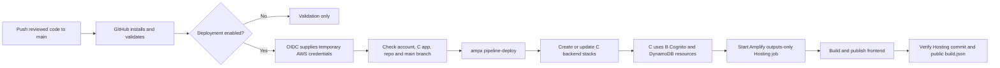

# Project5: deploy C through GitHub Actions

Configured 15 October 2026. Subsequent pushes to `main` deploy the backend and publish the frontend after validation. This replaces the terminal backend-deployment command in Step 11 during the **Step 9–12 reference-QA phase**.

C already exists as **`d3bsim6mrnq854` / `main`**, with backend root **`amplify-d3bsim6mrnq854-main-branch-62962b63d8`**. The GitHub OIDC provider is reused, the `Project5GitHubDeploy` role has been created, and repository variables have been configured. The first validation passed with deployment disabled, after which deployment was enabled and the first backend/frontend workflow succeeded. Automatic deployment is now enabled for main. The commands below record the setup for reuse; inspect existing resources before rerunning creation commands. The final live results are recorded in `CICD-VERIFICATION.md`.



B retains native resource ownership during reference QA. The workflow does not run a Gen1 migration command or ownership refactor. C's stream consumer remains disabled by the existing backend code.

## 1. Create/reuse C and record its actual app ID

1. Open AWS Amplify in account **112097210422**, Region **ap-south-1**.
2. Reuse C if it exists. Otherwise create a hosted app, connect **gowthammail4macair/project5**, choose **main**, and name it **project5**.
3. Keep the current repository buildspec during creation. It contains no `pipeline-deploy`. Cancel any initial Hosting build started by the wizard; missing reference inputs/outputs can make that setup build fail.
4. In C → **App settings → Branch settings**, disable **Auto-build** for `main`. Keep automatic branch creation and pull-request backend previews off.
5. Copy C's actual app ID from its overview. An app/branch record does not prove that its backend has been deployed.

In the Mac terminal, replace the placeholder and run the commands below. Run blocks in order and stop if any command fails.

```bash
export PROJECT5_DIR='/Users/testadmin/Documents/AmplifyGen1_to_Gen2_migration/project5-migration/project5-generation'
export EVIDENCE_DIR='/Users/testadmin/Documents/AmplifyGen1_to_Gen2_migration/project5-migration/private-evidence'
export AWS_REGION='ap-south-1'
export GEN2_APP_ID='d3bsim6mrnq854'
export GEN2_BRANCH='main'
export PROJECT5_DEPLOY_ROLE_ARN='arn:aws:iam::112097210422:role/Project5GitHubDeploy'
cd "$PROJECT5_DIR"
GITHUB_REF=refs/heads/main node scripts/project5-deploy-check.cjs config
mkdir -p "$EVIDENCE_DIR"
chmod 700 "$EVIDENCE_DIR"
printf '%s\n' "$GEN2_APP_ID" > "$EVIDENCE_DIR/C-app-id.txt"
```

The check rejects the preview ID, original Gen1 app ID, wrong Region and invalid role ARN. `dprojectfivepreview` is only for offline synthesis.

## 2. Verify the administrator session and existing OIDC provider

Use the AWS CLI session for this lab account with permission to configure its deployment role. For a named profile, set `AWS_PROFILE` to that profile and refresh its login if needed.

```bash
aws sts get-caller-identity --query Account --output text
aws iam get-open-id-connect-provider \
  --open-id-connect-provider-arn arn:aws:iam::112097210422:oidc-provider/token.actions.githubusercontent.com \
  --query '{Url:Url,Audiences:ClientIDList}'
```

Expected account: `112097210422`. Expected URL: `token.actions.githubusercontent.com`; audiences must include `sts.amazonaws.com`. Reuse this existing provider.

The prepared [trust policy](project5-github-trust.json) permits this repository's **main branch**. A GitHub API check confirmed `use_default=true`, `use_immutable_subject=true` and this subject prefix:

```text
repo:gowthammail4macair@292183841/project5@1414028395
```

The policy adds `:ref:refs/heads/main` to that prefix. Do not substitute an older name-only example. The workflow has no GitHub `environment:` setting; adding one changes the subject and requires updating the trust policy. [GitHub AWS OIDC documentation](https://docs.github.com/en/actions/how-tos/secure-your-work/security-harden-deployments/oidc-in-aws).

## 3. Create the GitHub deployment role

These are one-time AWS changes. If `Project5GitHubDeploy` already exists when you reach this step, inspect its trust and permissions and reuse it; do not overwrite another role blindly. The role was created for this setup on 15 October 2026.

```bash
aws iam create-role \
  --role-name Project5GitHubDeploy \
  --assume-role-policy-document file://docs/project5-github-trust.json \
  --description 'GitHub main deployment for Project5 reference QA'

aws iam attach-role-policy \
  --role-name Project5GitHubDeploy \
  --policy-arn arn:aws:iam::aws:policy/service-role/AmplifyBackendDeployFullAccess
```

AWS's [Amplify deployment policy](https://docs.aws.amazon.com/aws-managed-policy/latest/reference/AmplifyBackendDeployFullAccess.html) grants deployment through CDK bootstrap roles. It is broader than a single-app permission boundary. In an office account use your platform team's approved role/policy. The workflow's target checks prevent configuration mistakes; they are not an IAM isolation boundary.

Add access to read C's app/branch metadata, using its **actual app ID**:

```bash
node <<'NODE'
const fs = require('node:fs');
const assert = require('node:assert/strict');
const appId = process.env.GEN2_APP_ID;
assert.match(appId || '', /^d[a-z0-9]+$/);
assert.notEqual(appId, 'dprojectfivepreview');
const appArn = `arn:aws:amplify:ap-south-1:112097210422:apps/${appId}`;
fs.writeFileSync(process.env.EVIDENCE_DIR + '/project5-ci-metadata-policy.json', JSON.stringify({
  Version: '2012-10-17',
  Statement: [
    { Effect: 'Allow', Action: 'amplify:GetApp', Resource: appArn },
    { Effect: 'Allow', Action: 'amplify:GetBranch', Resource: appArn + '/branches/main' },
    { Effect: 'Allow', Action: ['amplify:StartJob', 'amplify:GetJob'], Resource: appArn + '/branches/main/jobs/*' }
  ]
}, null, 2) + '\n', { mode: 0o600 });
NODE

aws iam put-role-policy \
  --role-name Project5GitHubDeploy \
  --policy-name ReadProject5DeploymentTarget \
  --policy-document "file://$EVIDENCE_DIR/project5-ci-metadata-policy.json"
```

The account already has the CDK bootstrap stack/assets checked for Step 11. Do not create another bootstrap stack. The first CI deployment will verify actual role access; account policies and permission boundaries still apply.

## 4. Load B's reference inputs and restore the real C app ID

GitHub runners do not inherit your terminal exports. Load and validate the reviewed values before copying them into GitHub.

```bash
source "$EVIDENCE_DIR/project5-step9-inputs.sh"
# The inputs file contains the preview ID: replace it AFTER sourcing.
export GEN2_APP_ID="$(cat "$EVIDENCE_DIR/C-app-id.txt")"
export GEN2_BRANCH='main'
export AWS_REGION='ap-south-1'
export PROJECT5_DEPLOY_ROLE_ARN='arn:aws:iam::112097210422:role/Project5GitHubDeploy'
cd "$PROJECT5_DIR"
GITHUB_REF=refs/heads/main node scripts/project5-deploy-check.cjs live
npm run validate
```

The `live` check reads AWS using your local credentials; it confirms C's target and disabled Auto-build, but does not test GitHub authentication. `validate` checks TypeScript, tests and reference synthesis. Review synthesis with the actual C app ID.

Copy all nine B inputs from the saved file:

| GitHub variable | Value/source |
|---|---|
| `TEST_USER_POOL_ID` | `ap-south-1_zgT2JWoBE` |
| `TEST_WEB_CLIENT_ID` | `6ugasqqj1n74lb521orpj047pd` |
| `TEST_IDENTITY_POOL_ID` | `ap-south-1:5b136f2a-0291-4e1b-9a6b-006cfa7767e2` |
| `TEST_AUTH_ROLE_ARN` | B authenticated identity role ARN from the saved inputs |
| `TEST_UNAUTH_ROLE_ARN` | B unauthenticated identity role ARN from the saved inputs |
| `TEST_CONNECTIONS_TABLE_ARN` | B Connections table ARN from the saved inputs |
| `TEST_TICKET_STREAM_ARN` | B Ticket stream ARN from the saved inputs |
| `TEST_SOURCE_WEBSOCKET_API_ID` | `a61vb7pyxd` |
| `TEST_SOURCE_WEBSOCKET_STAGE` | `pftest` |

`PROJECT5_ALLOWED_ORIGINS` is the JSON array `["http://localhost:3000","https://main.d3bsim6mrnq854.amplifyapp.com"]`. Set it after sourcing the saved inputs file, which contains only localhost:

```bash
export PROJECT5_ALLOWED_ORIGINS='["http://localhost:3000","https://main.d3bsim6mrnq854.amplifyapp.com"]'
``` B's identity roles are separate from the GitHub deployment role.

## 5. Configure GitHub repository variables with deployment disabled

Open **GitHub → gowthammail4macair/project5 → Settings → Secrets and variables → Actions → Variables** and create repository variables. Alternatively, use these commands with authenticated GitHub CLI access:

```bash
gh auth status
gh variable set PROJECT5_DEPLOY_ENABLED --repo gowthammail4macair/project5 --body false

for variable_name in \
  AWS_REGION GEN2_APP_ID PROJECT5_DEPLOY_ROLE_ARN PROJECT5_ALLOWED_ORIGINS \
  TEST_USER_POOL_ID TEST_WEB_CLIENT_ID TEST_IDENTITY_POOL_ID \
  TEST_AUTH_ROLE_ARN TEST_UNAUTH_ROLE_ARN TEST_CONNECTIONS_TABLE_ARN \
  TEST_TICKET_STREAM_ARN TEST_SOURCE_WEBSOCKET_API_ID TEST_SOURCE_WEBSOCKET_STAGE
do
  variable_value="$(printenv "$variable_name")"
  if [ -z "$variable_value" ]; then
    printf 'Missing variable: %s\n' "$variable_name"
    break
  fi
  gh variable set "$variable_name" --repo gowthammail4macair/project5 --body "$variable_value" || break
done

gh variable list --repo gowthammail4macair/project5
```

Stop if the loop reports an error. Confirm all **14** entries: the enable switch, four general settings and nine `TEST_*` inputs. `GEN2_BRANCH` is fixed to `main` in the workflow. No AWS access key/secret key is stored in GitHub; OIDC supplies temporary credentials.

## 6. Review, commit and push the prepared files

```bash
cd "$PROJECT5_DIR"
git branch --show-current
git status --short
git diff -- .github/workflows/deploy.yml README.md
git add -- .github/workflows/deploy.yml README.md \
  scripts/project5-deploy-check.cjs test/project5-deploy-check.test.cjs \
  docs/project5-github-trust.json docs/GITHUB-ACTIONS-DEPLOYMENT.md \
  scripts/project5-hosting-release.cjs scripts/project5-smoke-test.cjs \
  scripts/build-frontend.cjs amplify.yml package-lock.json docs/STEP8-REPAIRS.md
git diff --cached --check
git diff --cached
git commit -m "Add GitHub OIDC deployment for Project5 reference QA"
git push origin main
```

The branch must be `main`. Review the staged diff before committing. Keep private evidence and `amplify_outputs.json` out of Git.

In **GitHub → Actions → Validate and deploy Project5**, inspect this push's run. `validate` must pass; `deploy` should be **skipped** while the enable switch is false. The validation artifact is named `project5-reference-validation`.

## 7. Enable deployment and start the first GitHub run

After setup, actual-C synthesis and validation pass:

```bash
gh variable set PROJECT5_DEPLOY_ENABLED --repo gowthammail4macair/project5 --body true
gh workflow run deploy.yml --repo gowthammail4macair/project5 --ref main
```

Or set the variable to exactly `true`, then use **Actions → Validate and deploy Project5 → Run workflow → main**.

The runner performs these operations:

1. Installs locked dependencies with `npm ci`, including the existing importer repair.
2. Runs `npm run validate` for types, tests and reference synthesis.
3. After validation succeeds, checks the actual C app ID and role configuration.
4. Exchanges GitHub's OIDC identity for temporary AWS credentials.
5. Reads AWS to verify account, Region, C's Project5 repository connection, `main` and disabled Auto-build.
6. Runs `npx ampx pipeline-deploy --app-id "$GEN2_APP_ID" --branch main` with `CI=1`, deploying the workflow run's commit.
7. Starts C main's Amplify Hosting `RELEASE` job, waits for success, and verifies that its commit ID matches the workflow.
8. Fetches the public `build.json` and confirms the same commit plus B's pool/client IDs. Hosting only retrieves outputs and builds the frontend; it does not deploy the backend again.

This can perform C's **first backend deployment** if it has none yet. If C was deployed from the terminal already, it updates the same app/branch backend. [AWS custom-pipeline instructions](https://docs.amplify.aws/react/deploy-and-host/fullstack-branching/custom-pipelines/).

Wait for the **deploy** job to succeed and inspect C's CloudFormation root/nested stacks. Then complete Step 11's outputs checks and Step 12's live QA. A green validation job alone is not deployment success. Avoid simultaneous terminal deployments; workflow concurrency only serializes this GitHub workflow.

## 8. Future updates and pausing deployment

After editing, reviewing and validating changes locally:

```bash
git add -- PATHS_YOU_REVIEWED
git commit -m "Describe the change"
git push origin main
```

Replace `PATHS_YOU_REVIEWED` with actual paths. GitHub automatically validates, deploys the backend, and publishes the frontend. You no longer run `pipeline-deploy` on the Mac for these routine QA changes. Use **Run workflow** for a reviewed retry after investigating a failure.

To pause future deployments while keeping validation:

```bash
gh variable set PROJECT5_DEPLOY_ENABLED --repo gowthammail4macair/project5 --body false
```

This does not cancel or roll back a deployment already running. Wait for active operations to reach a stable state before changing deployment ownership.

## 9. Frontend and later ownership-transfer checkpoints

The workflow deploys C's backend, then calls `amplify start-job` for C's `main` branch and waits for the Hosting job. The checked-in `amplify.yml` installs Node 22/npm 11.13.0, fetches the existing backend outputs, and builds `frontend/dist`. `build.json` records `AWS_COMMIT_ID`, enabling verification against the GitHub run SHA. Auto-build remains disabled. GitHub variables do not automatically populate Hosting variables; this outputs-only build does not need B synthesis variables.

`RELEASE` normally uses the branch's latest change. The script supplies the run SHA and verifies both the reported job commit and the published manifest. If either differs, the GitHub run fails: inspect it before starting another deployment. Do not run a terminal backend deployment or an independent Hosting release concurrently with this pipeline. [AWS StartJob reference](https://docs.aws.amazon.com/cli/latest/reference/amplify/start-job.html).

Before live WebSocket testing, B's active broadcaster must have callback permission for C's endpoint. For this C deployment, the B Lambda source template adds exactly `arn:aws:execute-api:ap-south-1:112097210422:tuw5ja3x1i/main/*/@connections/*` to `connections-and-callbacks`; B's existing pftest permission remains. Deploy that change through B's Gen1 control checkout (`amplify push` while selected environment is pftest). Do not enable C's stream mapping: B remains the single active stream consumer. This policy update changes permission on B's Lambda role and does not transfer Cognito/table ownership. B's local source commit is `3cedffe`. Its exact source patch is saved in [project5-B-qa-prerequisites.patch](project5-B-qa-prerequisites.patch) for review; it is specific to this B/C pair and is not a generic patch for another environment. The Gen1 repository was not pushed to GitHub.

The initial B push exposed another source/configuration gap: deletion protection had been enabled directly in AWS, but B's source did not declare it, so the normal push reset it. The correction declares it in `api/supportGraphql/override.ts` for Ticket and `custom/ticketSocket/cdk-stack.ts` for Connections, then deploys through B. Both physical table IDs stayed the same and both protections were restored to `true`. Keep those declarations in B for future schema/infra work during QA; do not rely on a one-time console setting.

To rerun the live application suite from the Project5 directory after deploying:

```bash
# Uses your authorized local AWS CLI credentials, never customer credentials in GitHub.
node scripts/project5-smoke-test.cjs
```

This creates four temporary users (email delivery suppressed), tests customer/Agents authorization, REST/GraphQL CRUD and comments, plus WebSocket reads and stream notifications, and cleans up its own users, tickets and sockets. Review `evidence/live-smoke.json`, including cleanup results. It preserves the saved demo account. The Lambda log probe and exact deployment/run evidence are recorded in `CICD-VERIFICATION.md`.

**Before Step 13 managed-placeholder work or ownership transfer, set `PROJECT5_DEPLOY_ENABLED=false` and wait for active deployments to finish.** The current validation mode and safeguards are for reference QA. Review/update the workflow, validation mode, permissions and deployment checkpoints for managed/post-refactor code before re-enabling CI. A cutover preparation push must not automatically deploy a different ownership model.

## Troubleshooting

| Failure | Check |
|---|---|
| Missing `TEST_*` or validation fails | Repository variables, exact B inventory and source/schema compatibility |
| Deploy skipped | Switch is `true`, ref is `main`, validation passed |
| OIDC `AccessDenied` | Role ARN, audience and exact immutable subject in the trust JSON |
| `GetApp` / `GetBranch` denied | Inline metadata policy contains the actual C app ARN |
| Target check fails | C app/repository/Region/main and disabled Hosting Auto-build |
| CDK deployment denied | Deployment policy, bootstrap-role trust, account permission boundaries |
| Imported-table management denied | B's current configuration and reference mapping; preserve the table-write deny safeguards |
| CloudFormation fails | Read failed events, wait for stable rollback, fix the cause, then retry |

Initial preparation checks passed on local Node 24.16.0: TypeScript, all 40 tests (including deployment-target rejection cases), reference synthesis, workflow YAML parsing and shell syntax. On 15 October, a follow-up lockfile repair passed a full clean install on Node 22.22.0/npm 10.9.4, followed by TypeScript, the 40 tests, reference synthesis and frontend packaging. Include that repaired lockfile in the reviewed commit. The live runs and runtime evidence are recorded in [CICD-VERIFICATION.md](CICD-VERIFICATION.md).
